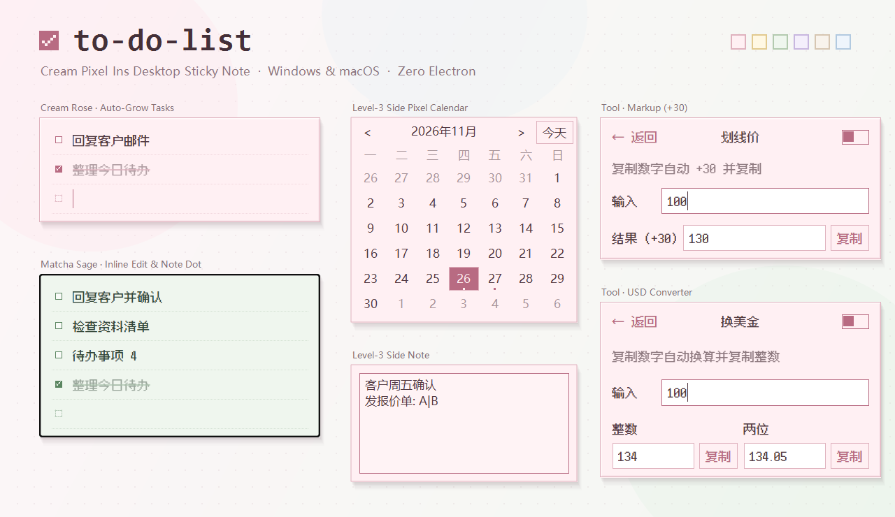
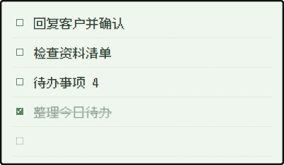
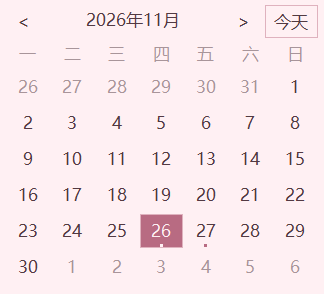
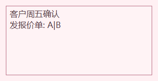
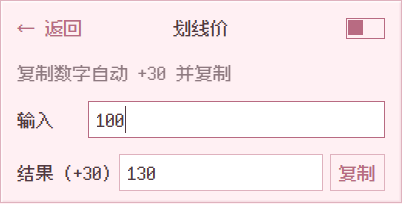

<div align="center">


# to-do-list

**极简奶油像素风 Ins 桌面便签 · 零 Electron 膨胀 · 悬停左上角 60fps 丝滑呼出**

[](#windows-10--11)
[](#macos-12)
[](#linux-x11--wayland)
[](https://evie-vv1ea.github.io/daily-todo-pwa/)
[](#架构与目录结构)
[](./LICENSE)

**简体中文** · [English](./README_EN.md) · [在线预览 PWA](https://evie-vv1ea.github.io/daily-todo-pwa/)

<br />



</div>

---

## ✨ 为什么选择 `to-do-list`？

市面上的待办工具往往需要打开一个几十兆甚至几百兆的独立窗口，打断你的工作心流。`to-do-list` 为**极致隐形与随手记录**而生：

- 🎨 **真正的 Ins 奶油像素美学** — 内置 12px 原生网格 [Fusion Pixel SC](https://github.com/TakWolf/fusion-pixel-font) 中文字体、6 套低饱和奶油莫兰迪配色、细腻 1px 像素边框、纸张虚线分隔、`7×7px` 精致像素勾选框与 `5×5px` 居中像素勾，支持三档柔和半透明（`80% / 88% / 95%`）。
- 🖱️ **左上角热区 · 60fps 丝滑呼出与自动隐身** — 平时完全隐藏在后台（无桌面图标、无任务栏/Dock 占位）；鼠标移到屏幕最左上角即以 60fps 缓动微滑淡入，移开后柔和淡出收起，收起中途移回还能无缝反向接续展开。
- 🧩 **不遮挡、不撑大的三级侧边交互** — `主便签（1 级）→ 主题配色右键菜单（2 级）→ 菜单旁弹出的紧凑月历 / 备注框（3 级）`。翻月、改期、写多行备注时，原便签始终清晰可见且尺寸纹丝不动。
- ✍️ **记事本级原地编辑 & 自动长高** — 没任务时仅显示 2 行极简空白；输入回车自动顺延新增行（最多展开至 12 行后才滚动）；点击任意任务文字直接原地修改、自动保存，`↑ / ↓` 跨行跳转，清空后按 `Backspace` 直接删除。
- 🧰 **内置日常效率小工具** — 右键即用 **每日自动清空剪贴板（20:00 清零）**、**划线价（+30）**、**换美金（×1.3405 整数/两位）**，支持剪贴板自动监听并一键回写结果。
- ⚡ **零 Electron、100% 本地离线隐私** — Windows 端基于原生 C# WinForms + 系统 Edge WebView2（可执行文件仅 **~84 KB**），macOS 端基于原生 Swift AppKit + 系统 WKWebView，Linux 端基于原生 GTK 3 + 系统 WebKit2GTK（单文件仅 **~54 KB**），无任何账号登录、无任何云端上传。

---

## ⚖️ 对比传统桌面待办

| 特性 | `to-do-list` | 传统 Electron 待办软件 | 浏览器网页版 |
| :--- | :---: | :---: | :---: |
| **原生外壳体积** | **~84 KB (Win) / Swift (Mac) / ~54 KB (Linux)** | 150 ~ 300 MB | 依赖浏览器窗口 |
| **日常桌面占位** | **0（隐身于左上角热区）** | 占任务栏 / Dock | 占标签页 |
| **展开与收起动效** | **60fps 缓动滑入淡出（可打断反转）** | 窗口切换 | 手动切窗口 |
| **编辑备注 / 切日期** | **三级侧边小界面，绝不覆盖主便签** | 弹窗遮挡列表 | 弹窗遮挡 |
| **数据隐私** | **100% 本地存储，零网络请求** | 多数强绑定云端账号 | 本地 / 云端 |

---

## 🖼️ 功能与界面预览

<table>
  <tr>
    <td align="center" width="50%">
      <br />
      <sub><b>奶油藕粉</b> · 极小 7×7px 像素方框、柔和划线、随任务数自动长高</sub>
    </td>
    <td align="center" width="50%">
      <br />
      <sub><b>抹茶鼠尾草</b> · 点击文字直接原地编辑，右侧 3×3px 备注微点指示</sub>
    </td>
  </tr>
  <tr>
    <td align="center">
      <br />
      <sub><b>三级侧边月历</b> · 菜单旁直接弹出，支持翻月与任务微点标记，不覆盖主便签</sub>
    </td>
    <td align="center">
      <br />
      <sub><b>三级侧边备注</b> · 多行输入实时自动保存，点外部或 Esc 自动收起</sub>
    </td>
  </tr>
  <tr>
    <td align="center">
      <br />
      <sub><b>工具 → 划线价</b> · 独立像素风卡片 + 直角像素剪贴板监听开关</sub>
    </td>
    <td align="center">
      <br />
      <sub><b>工具 → 换美金</b> · 整数 / 两位小数双结果独立一键复制</sub>
    </td>
  </tr>
</table>

---

## 🚀 快速开始

### Windows 10 / 11

> 零第三方依赖：使用 Windows 内置 `.NET Framework csc.exe` 编译并自动拉取微软官方 WebView2 绑定库，自动配置开机静默自启，保留已有本地数据。

**方式一：PowerShell 一键安装（推荐）**

```powershell
irm https://raw.githubusercontent.com/Evie-vv1ea/daily-todo-pwa/main/windows/install.ps1 | iex
```

**方式二：克隆仓库本地构建安装**

```powershell
git clone https://github.com/Evie-vv1ea/daily-todo-pwa.git
cd daily-todo-pwa
powershell -ExecutionPolicy Bypass -File ./windows/install.ps1
```

**卸载（默认保留本地任务数据）**

```powershell
powershell -ExecutionPolicy Bypass -File ./windows/uninstall.ps1
# 如需连同本地数据一起清除：
powershell -ExecutionPolicy Bypass -File ./windows/uninstall.ps1 -RemoveData
```

---

### macOS 12+

> 原生 Swift AppKit + WKWebView（Apple Silicon & Intel 均原生编译，零 Electron 依赖），配置 `LSUIElement` 无 Dock 图标后台常驻与 `LaunchAgent` 开机自启。需要已安装 Apple Command Line Tools（`xcode-select --install`）。

**方式一：终端一键安装（推荐）**

```bash
curl -fsSL https://raw.githubusercontent.com/Evie-vv1ea/daily-todo-pwa/main/macos/install.sh | bash
```

**方式二：克隆仓库本地构建安装**

```bash
git clone https://github.com/Evie-vv1ea/daily-todo-pwa.git
cd daily-todo-pwa
bash ./macos/install.sh
```

**卸载**

```bash
bash ./macos/uninstall.sh
```

---

### Linux (X11 / Wayland)

> 原生 GTK 3 + WebKit2GTK（自动兼容 `WebKit2 4.1 / 4.0`，零 Electron 依赖、无需编译工具链），遵循 XDG 规范自动注册应用菜单与 `~/.config/autostart` 开机自启。
> - **X11 桌面**：原生支持屏幕左上角热区悬停 60fps 丝滑呼出与自动收起。
> - **Wayland 桌面**（GNOME / KDE / Hyprland 等）：支持单实例 `--toggle` 命令，可将 `~/.local/bin/to-do-list --toggle` 绑定为系统快捷键（如 `Super+T`）一键呼出/隐藏。

**前置系统依赖（如尚未预装）**

```bash
# Ubuntu / Debian / Linux Mint（旧版 20.04/22.04 可将 4.1 替换为 4.0）
sudo apt install -y python3-gi python3-gi-cairo gir1.2-gtk-3.0 gir1.2-webkit2-4.1

# Fedora / RHEL
sudo dnf install -y python3-gobject python3-cairo gtk3 webkit2gtk4.1

# Arch / Manjaro
sudo pacman -S --needed python-gobject python-cairo gtk3 webkit2gtk-4.1
```

**方式一：终端一键安装（推荐）**

```bash
curl -fsSL https://raw.githubusercontent.com/Evie-vv1ea/daily-todo-pwa/main/linux/install.sh | bash
```

**方式二：克隆仓库本地安装**

```bash
git clone https://github.com/Evie-vv1ea/daily-todo-pwa.git
cd daily-todo-pwa
bash ./linux/install.sh
```

**卸载（默认保留本地任务数据）**

```bash
bash ./linux/uninstall.sh
# 如需连同本地数据一起清除：
bash ./linux/uninstall.sh --remove-data
```

---

### Web / PWA 浏览器版

无需安装，直接访问在线版（支持 Chrome / Edge「安装为应用」离线使用）：

👉 **[https://evie-vv1ea.github.io/daily-todo-pwa/](https://evie-vv1ea.github.io/daily-todo-pwa/)**

---

## ⌨️ 交互与快捷键速查

| 操作 | 效果 |
| :--- | :--- |
| **鼠标移到屏幕最左上角（停留 0.12s）** | 60fps 丝滑展开便签；移开鼠标 0.26s 后自动淡出收起 |
| **点击空白行输入 → `Enter`** | 添加新任务，自动向下长高一行并聚焦新空行（支持自然语言识别 `今天 / 明天 / 后天 / 周三 / 11月28日`） |
| **点击任意任务文字** | 直接原地编辑，输入实时保存；`Enter` 跳下一行，`Esc` 撤销本次修改 |
| **清空任务文字后再按 `Backspace`** | 直接删除该条任务并回到上一行 |
| **`↑` / `↓` 方向键** | 在所有任务行与底部空白输入行之间平滑切换焦点 |
| **点击左侧 `7×7px` 像素方框** | 勾选完成（像素勾 + 柔和划线），再次点击恢复未完成 |
| **右键任务 / 空白处** | 打开同色系原生右键菜单（全部设置与工具入口） |

---

## 🖱️ 右键菜单与三级浮窗一览

```text
右键菜单（Level 2）
├── [右键某条任务时显示]
│   ├── 备注 ──────────────▶ 三级侧边多行备注框（实时保存，不覆盖主便签）
│   ├── 切换时间 ──────────▶ 三级侧边像素迷你月历（直接修改该任务日期）
│   ├── 延期一天
│   └── 删除任务
├── 新增任务
├── 清理已完成
├── 便签颜色 ▶ 奶油藕粉 / 黄油奶黄 / 抹茶鼠尾草 / 芋泥淡紫 / 海盐燕麦 / 冰川奶蓝
├── 透明度   ▶ 轻透 (80%) / 柔和 (88%) / 清晰 (95%)
├── 筛选任务 ▶ 当日 / 全部 / 延期
├── 切换日期 ──────────────▶ 三级侧边像素迷你月历（切换当日视图，不覆盖主便签）
├── 固定在左上角（勾选后常驻显示不自动收起）
├── 新增选项（本周每天）
├── 剪贴板（每日 20:00 自动清空）
├── 工具 ▶ 划线价 (+30) / 换美金 (×1.3405)
└── 退出桌面便签
```

---

## 🎨 内置 6 套 Ins 奶油像素色板

| 主题名 | 纸面底色 | 像素边框 | 文字墨色 | 强调色 |
| :--- | :---: | :---: | :---: | :---: |
| **奶油藕粉** (`rose`) | `#FFF0F3` | `#DFB2BE` | `#523A42` | `#B86B82` |
| **黄油奶黄** (`butter`) | `#FFF8E3` | `#E2CA8F` | `#54462A` | `#AD8736` |
| **抹茶鼠尾草** (`sage`) | `#EFF6EE` | `#B3CAAF` | `#354839` | `#5A8560` |
| **芋泥淡紫** (`lilac`) | `#F4EFFB` | `#C8B7DF` | `#453958` | `#7E64A8` |
| **海盐燕麦** (`oat`) | `#F8F3EC` | `#D6C6B2` | `#4B3F35` | `#8E735A` |
| **冰川奶蓝** (`sky`) | `#EEF5FC` | `#B2CAE0` | `#334759` | `#5A84AB` |

---

## 🏗️ 架构与目录结构

全平台共享唯一前端单文件 [index.html](./index.html)，通过极简字符串消息协议（`window.chrome?.webview || window.desktopNote`）与系统原生外壳双向通信：

```text
daily-todo-pwa/
├── index.html                    # 全平台共享核心前端（Windows / macOS / Linux / Web PWA）
├── fusion-pixel-sc.woff2         # 12px 原生像素中文字体（SIL OFL 1.1）
├── manifest.webmanifest          # PWA 清单
├── service-worker.js             # PWA 离线缓存
├── windows/
│   ├── DesktopNote.cs            # Windows 原生壳（WinForms + WebView2 + 60fps 动效 + 三级浮窗 + 热更新）
│   ├── install.ps1               # Windows 一键编译安装与开机自启脚本
│   └── uninstall.ps1             # Windows 一键卸载脚本
├── macos/
│   ├── DesktopNote.swift         # macOS 原生壳（AppKit + WKWebView + 60fps 动效 + 三级浮窗 + 热更新）
│   ├── Info.plist                # 无 Dock 图标后台常驻配置（LSUIElement=true）
│   ├── install.sh                # macOS 一键编译打包 .app 与 LaunchAgent 自启脚本
│   └── uninstall.sh              # macOS 一键卸载脚本
├── linux/
│   ├── desktop_note.py           # Linux 原生壳（GTK 3 + WebKit2GTK + 60fps 动效 + 三级浮窗 + IPC + 热更新）
│   ├── to-do-list.desktop        # XDG 桌面入口模板
│   ├── install.sh                # Linux 一键安装与 XDG 开机自启脚本
│   └── uninstall.sh              # Linux 一键卸载脚本
└── assets/                       # README 展示截图
```

---

## 🛠️ 开发、热更新与自动化自测

- **实时热更新**：Windows、macOS 与 Linux 原生外壳均内置了 `app/index.html` 文件监听（250ms 防抖），修改前端样式或脚本后保存即可自动刷新，无需重启桌面进程。
- **Windows 端自动化端到端自测**：
  ```powershell
  & "$env:LOCALAPPDATA\to-do-list\to-do-list.exe" --self-test
  ```
  自动校验：12px 像素字体加载、动态 2→3→5→12 行增高与回缩、行内原地编辑与键盘导航、三级侧边备注多行中文自动保存、三级侧边月历翻月与改期、独立工具卡计算、60fps 动画可打断反转、主题/透明度切换不改尺寸、固定与离屏收起，并输出 7 张回归验收图。

---

## 🙏 致谢与协议

- 像素字体采用开源字体 **[Fusion Pixel Font](https://github.com/TakWolf/fusion-pixel-font)**（12px Proportional SC），遵循 [SIL Open Font License 1.1](./fusion-pixel-license.txt)。
- 本项目源代码遵循 **[MIT License](./LICENSE)** 开源。如果这个小便签让你的桌面更清爽，欢迎点一颗 ⭐ **Star**！
