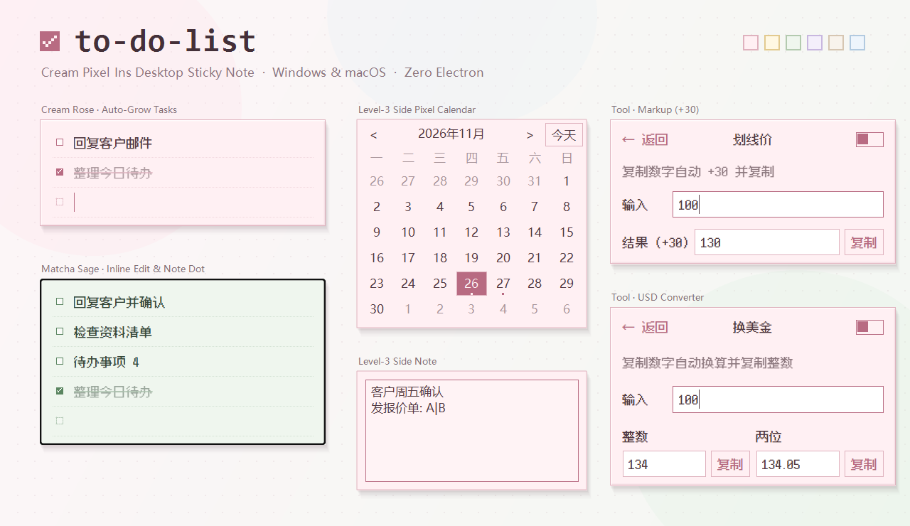

<div align="center">


# to-do-list

**Minimalist Cream-Pixel Ins Desktop Sticky Note · Zero Electron Bloat · 60fps Top-Left Corner Peek**

[](#windows-10--11)
[](#macos-12)
[](https://evie-vv1ea.github.io/daily-todo-pwa/)
[](#architecture)
[](./LICENSE)

[简体中文](./README.md) · **English** · [Live PWA Demo](https://evie-vv1ea.github.io/daily-todo-pwa/)

<br />



</div>

---

## ✨ Highlights

- 🎨 **Cream-Pixel Ins Aesthetic** — Native 12px [Fusion Pixel SC](https://github.com/TakWolf/fusion-pixel-font) bitmap typography, 6 curated low-saturation cream palettes, crisp 1px pixel frames, dotted memo ruling, tiny `7×7px` pixel checkboxes (`5×5px` checkmarks), and 3 translucency levels (`80% / 88% / 95%`).
- 🖱️ **60fps Top-Left Corner Peek** — Stays completely invisible in the background (zero desktop icon, zero taskbar/Dock clutter). Glide your pointer to the top-left corner for a smooth 60fps ease-out slide & fade; move away to dismiss, with seamless mid-animation reversal.
- 🧩 **3-Level Non-Covering Side Flyouts** — `Sticky Note (L1) → Themed Context Menu (L2) → Side Pixel Calendar / Multiline Note Editor (L3)`. Browse months, reschedule tasks, or jot down notes right beside the menu without ever covering or resizing the sticky note.
- ✍️ **Direct Inline Editing & Auto-Grow** — Shows 2 minimal blank rows when empty and grows row-by-row up to 12 rows as you press `Enter`. Click any task title to edit inline with instant auto-save, navigate rows via `↑ / ↓`, or press `Backspace` on an empty task to delete it.
- 🧰 **Built-in Micro-Tools** — Right-click access to a daily auto-clearing Clipboard (resets at 20:00), Markup Calculator (`+30`), and USD Converter (`×1.3405`) with optional live clipboard watching.
- ⚡ **Zero Electron & 100% Local-First** — Native C# WinForms + Edge WebView2 on Windows (**~84 KB** executable) and native Swift AppKit + WKWebView on macOS. No accounts, no cloud sync, no telemetry.

---

## 🚀 Quick Start

### Windows 10 / 11

No prerequisites required — builds directly with Windows' built-in `.NET Framework csc.exe`, fetches Microsoft's official WebView2 bindings, registers auto-start on login, and preserves existing local data.

```powershell
# One-line install
irm https://raw.githubusercontent.com/Evie-vv1ea/daily-todo-pwa/main/windows/install.ps1 | iex

# Or install from a local clone
git clone https://github.com/Evie-vv1ea/daily-todo-pwa.git
cd daily-todo-pwa
powershell -ExecutionPolicy Bypass -File .\windows\install.ps1

# Uninstall (keeps local tasks by default; pass -RemoveData to delete all data)
powershell -ExecutionPolicy Bypass -File .\windows\uninstall.ps1
```

### macOS 12+

Compiles a native Swift AppKit + WKWebView `.app` bundle (`LSUIElement=true`, no Dock icon) and sets up a `LaunchAgent` for login auto-start. Requires Apple Command Line Tools (`xcode-select --install`).

```bash
# One-line install
curl -fsSL https://raw.githubusercontent.com/Evie-vv1ea/daily-todo-pwa/main/macos/install.sh | bash

# Or install from a local clone
git clone https://github.com/Evie-vv1ea/daily-todo-pwa.git
cd daily-todo-pwa
bash ./macos/install.sh

# Uninstall
bash ./macos/uninstall.sh
```

### Web / PWA

Try it directly in your browser (installable as an offline PWA):

👉 **[https://evie-vv1ea.github.io/daily-todo-pwa/](https://evie-vv1ea.github.io/daily-todo-pwa/)**

---

## ⌨️ Interactions & Shortcuts

| Action | Behavior |
| :--- | :--- |
| **Hover top-left corner (120ms)** | Smoothly slides & fades in the sticky note; auto-hides 260ms after cursor leaves |
| **Type in blank row → `Enter`** | Creates a task, auto-grows the note by one row, and focuses the next blank line |
| **Click any task title** | Edits inline with instant auto-save; `Enter` moves to next row, `Esc` reverts |
| **`Backspace` on cleared task** | Deletes the task cleanly and moves focus to the previous row |
| **`↑` / `↓` arrow keys** | Navigate smoothly across all tasks and blank draft rows |
| **Right-click task / empty area** | Opens themed native menu with 3rd-level side calendar, note editor, themes, opacity, pin, clipboard & tools |

---

## 🏗️ Architecture

Windows (`windows/DesktopNote.cs`), macOS (`macos/DesktopNote.swift`), and Web PWA all share the exact same single-file frontend ([index.html](./index.html)) via a lightweight string-message bridge (`window.chrome?.webview || window.desktopNote`), with built-in 250ms live hot-reload when `app/index.html` changes.

---

## 🙏 Credits & License

- Bundled pixel font: **[Fusion Pixel Font](https://github.com/TakWolf/fusion-pixel-font)** (12px Proportional SC), licensed under [SIL OFL 1.1](./fusion-pixel-license.txt).
- Source code licensed under the **[MIT License](./LICENSE)**.
